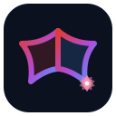
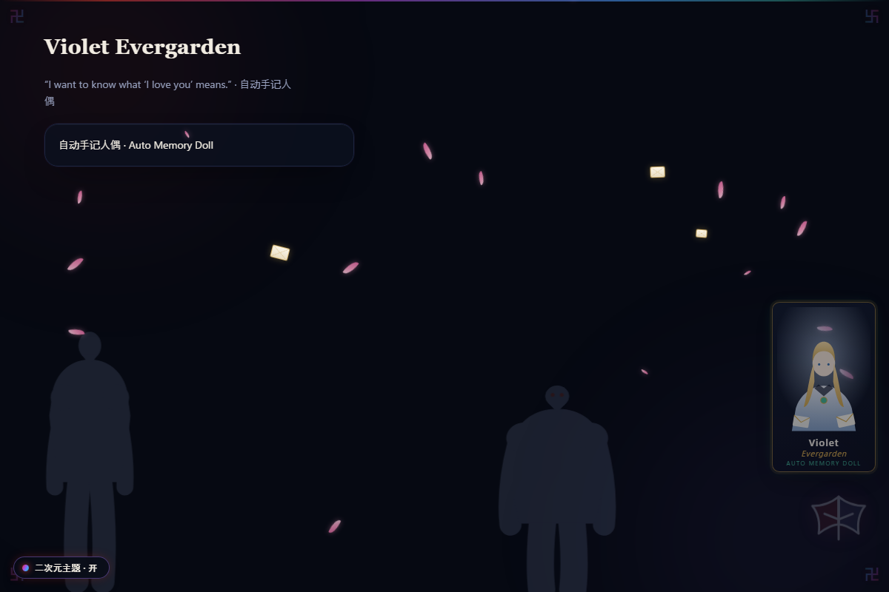

# dsh-anime-theme · 二次元暗色主题 for DeepSeek Harness

<p align="center">
  
</p>

<p align="center">
  A cinematic dark skin for the <a href="https://github.com/deepseek-ai/deepseek-harness">DeepSeek Harness (DSH)</a> Web GUI, blending the colour worlds of four anime into one cohesive theme.
  <br/>
  一个为 DeepSeek Harness（DSH）网页端打造的电影感暗色皮肤，把四部番剧的色彩融进同一套主题。
</p>

<p align="center">
  <a href="#features--效果">Features</a> ·
  <a href="#install--安装">Install</a> ·
  <a href="#usage--使用">Usage</a> ·
  <a href="#customize--自定义">Customize</a> ·
  <a href="#how-it-works--原理">How it works</a> ·
  <a href="#license--许可">License</a>
</p>

---

## Introduction · 简介

`dsh-anime-theme` is a **pure host-side DSH plugin** that reskins the Web GUI without touching any core logic. It pulls its palette from four series:

- **Attack on Titan / 进击的巨人** — Survey Corps crimson `#d83a30`, plus a simplified **Wings of Freedom** emblem and **titan silhouettes** (Attack, Armored & Cart Titan) slowly marching across the backdrop.
- **Bleach / 死神** — a deep ink-black ground, bone-white text, spiritual orange, and **卍 (manji) bankai marks** in all four corners.
- **Re:Zero / Re:从零开始的异世界生活** — Emilia's amethyst `#8a63d2` and Rem's azure `#4a9eff` woven through the brand gradient.
- **Violet Evergarden / 紫罗兰永恒花园** — teal / gold / emerald accents (`#2f8f86` / `#cda349` / `#3fae8f`), a soft cinematic **vignette**, a framed **portrait poster** in the corner (golden braids, the emerald brooch, letters in hand), **letters drifting on the wind**, and period **serif headings**.

It also unifies the typeface across the entire UI, adds drifting **senbonzakura petals** (Byakuya-style scattering blades), gradient scrollbars/buttons, a glowing focus ring, and a one-click toggle.



这是一个**纯宿主侧的 DSH 插件**，只给网页端换肤，不改动任何核心逻辑。配色取自四部作品：进击的巨人（调查兵团猩红 + 自由之翼徽记 + 背景里行走的巨人剪影：超大型 / 铠之 / 车力）、死神（墨黑底 + 骨白字 + 灵压橙 + 四角卍解标记）、Re:Zero（爱蜜莉雅紫水晶 + 蕾姆湛蓝）、紫罗兰永恒花园（青绿 / 金 / 祖母绿点缀 + 电影感暗角 + 角落的**人物海报**：金色发辫、祖母绿胸针、手持信笺，还有随风飘过的**信笺**与古典**衬线标题**）。此外还统一了全站字体、加入朽木白哉式的千本樱花瓣、渐变滚动条与按钮、发光焦点环，以及一键开关。

## Features · 效果

| | English | 中文 |
| --- | --- | --- |
| 🎨 Palette | Deepened dark base + crimson→amethyst→azure→teal gradient | 加深的暗色底 + 猩红→紫水晶→湛蓝→青绿渐变 |
| 🪽 Emblem | Breathing Wings-of-Freedom mark, bottom-right | 右下角会呼吸的自由之翼徽记 |
|  Titans | Colossal / Armored / Cart Titan ghost silhouettes (14% screen blend) drifting across the bottom — clearly visible, never dimming the text | 超大型 / 铠之 / 车力巨人以 14% 的浅色幽灵层横穿底部 —— 看得见，又不会压暗正文 |
| 🌸 Petals | Senbonzakura-style scattering pink blades | 朽木白哉式飘散的千本樱花瓣 |
| 卍 Corners | Bankai manji marks in all four corners | 四个角落的卍解标记 |
| 🖼️ Poster | Framed Violet Evergarden portrait (original SVG) with gold frame | 角落的紫罗兰永恒花园人物海报（原创 SVG，金框） |
| ✉️ Letters | Envelopes drifting across the screen on the wind | 随风飘过的信笺 |
| 🔤 Type | Unified font everywhere, serif headings (code stays monospace) | 全站统一字体，标题用衬线（代码区保留等宽） |
|  Depth | Ambient colour glows + cinematic vignette | 氛围光晕 + 电影感暗角 |
| 🔘 Toggle | Bottom-left pill, preference persisted locally | 左下角胶囊开关，偏好本地持久化 |
| ♿ A11y | Honours `prefers-reduced-motion` (no animation) | 尊重系统的「减少动态效果」设置 |

## Install · 安装

> Requires DeepSeek Harness **≥ 0.2.0-rc.2, < 0.2.2-0**. Works on the Desktop app and the plain Web profile.
> 需要 DeepSeek Harness **≥ 0.2.0-rc.2、< 0.2.2-0**。桌面端与纯 Web profile 均可用。

**1. Plugin market (recommended) · 插件市场**
In the DSH plugin market, choose a custom registry / source and install by package name `dsh-anime-theme`. Or point the market at this repo once it is published to a registry.
在 DSH 插件市场中选择自定义源，按包名 `dsh-anime-theme` 安装。

**2. DSH CLI · 命令行**
```console
dsh plugin --profile desktop add Incredible-Jian/dsh-Bleach-Violet-Evergarden-Re-Zero-AoT-Themes
# or, from a local clone:
dsh plugin --profile desktop add link:/absolute/path/to/dsh-anime-theme
```

**3. Local workspace bundle · 本地工作区**
Clone this repo anywhere, then in the agent / plugin manager install the bundle from its absolute directory. The Desktop profile picks it up immediately.
克隆本仓库到任意位置，然后在插件管理器里按它的绝对目录安装 bundle，桌面端 profile 会立即加载。

### After installing · 安装之后

⚠️ **Restart the DeepSeek Harness Desktop app once.** The desktop shell collects page-injection rows once at boot and caches them, so a plain page refresh will not pick up a freshly installed injection plugin — a restart is required for the theme to appear.
⚠️ **安装后请重启一次 DeepSeek Harness 桌面应用。** 桌面端在启动时一次性收集页面注入项并缓存，单纯刷新页面不会加载新装的注入插件——必须重启才会出现主题。

## Usage · 使用

- The theme is **on by default** once installed.
- Click the **「二次元主题 · 开/关」** pill at the bottom-left to toggle it instantly; the choice is saved in `localStorage` (`dsh-anime-theme-enabled`) and survives reloads.
- To remove it entirely, disable / uninstall the `dsh-anime-theme` row in the Plugins page.

- 安装后主题**默认开启**。
- 点左下角的 **「二次元主题 · 开/关」** 胶囊可即时切换；选择保存在 `localStorage`（`dsh-anime-theme-enabled`），刷新后仍保持。
- 想彻底移除：在插件页禁用 / 卸载 `dsh-anime-theme` 这一行即可。

## Customize · 自定义

All colours live at the top of [`theme.css`](theme.css) inside `html.dsh-anime { … }`. Edit, save, restart.
所有颜色都在 [`theme.css`](theme.css) 顶部的 `html.dsh-anime { … }` 里，改完保存、重启即可。

| Variable · 变量 | Role · 作用 |
| --- | --- |
| `--anime-crimson` / `--dsw-alias-brand-primary` | Primary accent — buttons, brand · 主强调色 |
| `--anime-amethyst` / `--anime-azure` | Re:Zero purple / blue in the gradient · 渐变里的紫 / 蓝 |
| `--anime-teal` / `--anime-gold` / `--anime-emerald` | Violet Evergarden accents · 紫罗兰永恒花园点缀 |
| `--anime-amber` | Bleach spiritual-orange (warn/hover) · 灵压橙 |
| `--dsw-alias-bg-base` / `-layer-1` / `-layer-2` | Three surface depths · 三层背景深浅 |
| `--dsw-specific-sidebar-fill` | Sidebar base · 侧栏底色 |
| `--anime-font` / `--anime-mono` | Unified UI font / code font · 统一字体 / 代码字体 |

Decorations (emblem `#dsh-anime-emblem`, petals `#dsh-anime-petals`, titans `#dsh-anime-titans`, corners `.dsh-anime-corner`, toggle `#dsh-anime-toggle`) are styled in the lower half of `theme.css`; the titan SVGs, senbonzakura logic and corner marks live in [`theme.js`](theme.js).
装饰元素（徽记、花瓣、巨人、角落标记、开关）的样式在 `theme.css` 下半部分；巨人 SVG、千本樱逻辑与卍角标在 [`theme.js`](theme.js)。

## How it works · 原理

This is a **host-only** plugin. On startup, [`index.js`](index.js) reads `theme.css` + `theme.js`, bundles them into one self-contained inline script, and injects it into the served Web GUI through DSH's `webserver/index-inject` channel (Desktop) and `tapIndex` (plain Web). Every style is scoped under the `html.dsh-anime` class, so the toggle is instant and the default theme is never affected. No build step, no client bundle, no external assets.
这是一个**纯宿主**插件。启动时 [`index.js`](index.js) 读取 `theme.css` + `theme.js`，打包成一段自包含的内联脚本，通过 DSH 的 `webserver/index-inject` 通道（桌面端）和 `tapIndex`（纯 Web 端）注入到网页。所有样式都收敛在 `html.dsh-anime` 类下，因此开关是瞬时的、不影响默认主题。无需构建、无客户端 bundle、无外部资源。

```
dsh-anime-theme/
├── index.js            # host entry: builds + injects the inline script
├── theme.css           # all styling, scoped under html.dsh-anime
├── theme.js            # vignette, titans, petals, 卍 corners, emblem, toggle
├── cordis.patch.yml    # mounts the plugin row into the profile
├── icon.svg            # plugin icon (wings + sakura)
├── locale/             # en.json / zh.json display metadata
├── package.json        # DSH bundle manifest
└── LICENSE             # MIT
```

## Compatibility · 兼容性

- DeepSeek Harness `>=0.2.0-rc.2 <0.2.2-0` (tested on `0.2.1-rc.3` Desktop).
- The Desktop app needs a **restart** after install/edits (boot-time injection caching); the plain Web profile picks changes up on refresh.
- Pure CSS/JS — no native binaries, no network calls at runtime.

## Disclaimer · 声明

This is an **unofficial fan-made theme**. It is inspired by the *colour palettes and motifs* of Attack on Titan, Bleach, Re:Zero and Violet Evergarden. It contains **no copyrighted artwork, logos, fonts, audio or video** from those series — the titan silhouettes, wings emblem and sakura are original, simplified SVG shapes drawn for this project. All series names and trademarks belong to their respective owners and are referenced here only to describe the visual inspiration.
这是一个**非官方的同人主题**，灵感来自上述四部作品的*配色与意象*。它**不包含**这些作品的任何受版权保护的美术、标志、字体、音频或视频——巨人剪影、自由之翼徽记与樱花均为本项目原创的简化 SVG 图形。所有作品名称与商标归各自权利人所有，此处仅用于描述视觉灵感来源。

## License · 许可

[MIT](LICENSE) © 2026 Incredible-Jian.

---

Made with 🪽 for late-night coding sessions. · 为深夜写代码而生。
